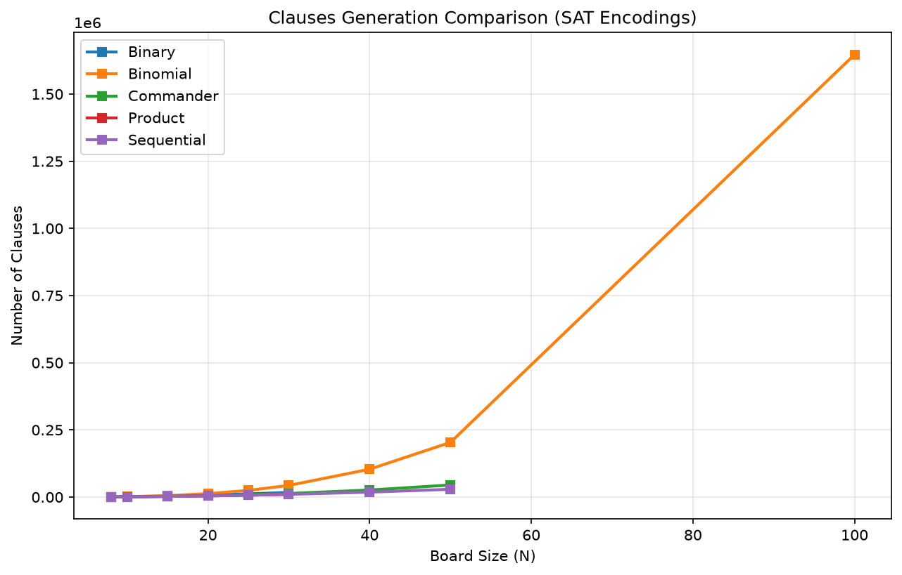
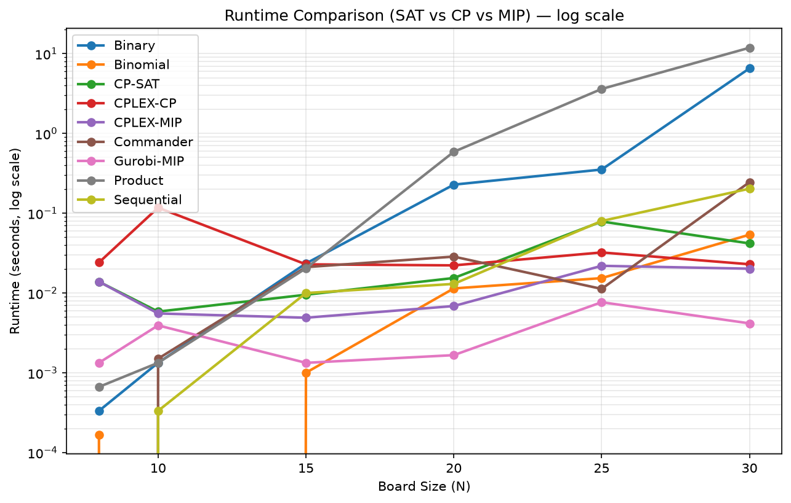

# N-Queens Problem: Exact SAT Solving vs Constraint Programming

[](https://www.python.org/)
[](https://pysathq.github.io/)
[](https://developers.google.com/optimization/cp/cp_solver)

Dự án này là đồ án môn học nhằm giải quyết bài toán N-Queens kinh điển bằng các phương pháp tối ưu hóa chính xác (Exact Optimization). Trọng tâm của đồ án là việc mô hình hóa bài toán sang Dạng chuẩn hội (CNF) để giải bằng **SAT Solver**, đồng thời đối chuẩn hiệu năng với mô hình **Constraint Programming (CP)**.

## 🌟 Tính năng nổi bật

Dự án triển khai và phân tích toán học 5 chuẩn mã hóa At-Most-One (AMO) khác nhau để chuyển đổi ràng buộc N-Queens sang logic mệnh đề:
1. **Binomial (Pairwise)**: Không dùng biến phụ, $O(n^2)$ mệnh đề.
2. **Sequential Counter**: Sinh $O(n)$ biến phụ, $O(n)$ mệnh đề.
3. **Binary**: Sinh $O(\log n)$ biến phụ.
4. **Commander**: Thuật toán chia nhóm, $O(\sqrt{n})$ biến phụ.
5. **Product**: Thuật toán ma trận 2D, $O(\sqrt{n})$ biến phụ.

Ngoài ra, dự án tích hợp thêm các bộ giải chính xác khác để đối chuẩn ba họ phương pháp:
- **Constraint Programming**: CP-SAT (Google OR-Tools) và CPLEX CP Optimizer (IBM).
- **Integer Linear Programming (ILP/MIP)**: CPLEX MIP (IBM) và Gurobi.

> **Ghi chú về PySAT encoders:** Ngoài 5 chuẩn mã hóa tự cài đặt trong `encoder.py`, dự án còn cung cấp `src/pysat_encoder.py` — phiên bản mã hóa AMO **gọi trực tiếp thư viện PySAT** thông qua `pysat.card.CardEnc` / `pysat.card.EncType`. Module này ánh xạ 5 chuẩn yêu cầu lên các encoder chuẩn của PySAT (`pairwise`, `seqcounter`, `bitwise`, `cardnetwrk`, `mtotalizer`) để đối chiếu chéo với phần cài đặt thủ công.

> **Ghi chú về cross-solver:** Dự án còn hỗ trợ đối chuẩn **cùng một mô hình CNF trên nhiều bộ giải SAT** (Glucose3, Glucose4, CaDiCaL, MapleSAT...) thông qua cú pháp `<solver>:<encoding>`. Kết quả cho thấy thứ hạng giữa các bộ giải **đảo chiều tùy theo encoding**, củng cố luận điểm rằng hiệu năng đến từ sự tương thích giữa bộ giải và cấu trúc mã hóa.

Tất cả các encoding SAT đều được áp dụng thêm kỹ thuật **phá đối xứng (symmetry breaking)** — ấn định quân hậu ở hàng đầu nằm ở nửa trái bàn cờ — giúp cắt giảm một nửa không gian tìm kiếm.

Hệ thống benchmark được thiết kế với tính năng **timeout độc lập qua đa tiến trình (multiprocessing)** để ngắt an toàn các bộ giải SAT chạy bằng thư viện C-extension mà không bị kẹt GIL trên Windows.

## 📊 Kết quả Thực nghiệm

Dự án cung cấp công cụ benchmark tự động chạy từ $N=8$ đến $N=30$. Mỗi cấu hình được chạy lặp lại **3 lần** và lấy giá trị trung bình nhằm loại bỏ nhiễu đo lường. Thời gian được tách thành hai thành phần riêng biệt: **thời gian sinh mệnh đề** (`Gen_Time`) và **thời gian giải** (`Solve_Time`). Nghiệm đầu ra của **toàn bộ 9 phương pháp** (5 encoding SAT, CP-SAT, CPLEX-CP, CPLEX-MIP, Gurobi) đều được **hậu kiểm độc lập** (`Solution_Valid`) để đảm bảo đúng $N$ quân và không tấn công nhau.

### 1. Sự bùng nổ mệnh đề (Clause Explosion)
Chuẩn Binomial phình to bộ nhớ cực nhanh theo hàm bậc hai, trong khi Sequential và Product giữ được số lượng mệnh đề rất nhỏ gọn nhờ các biến phụ.



### 2. Nghịch lý Thời gian giải (Runtime Bottleneck)
Mặc dù Product và Binary có rất ít mệnh đề, việc chèn thêm các "biến phụ" (auxiliary variables) làm nhiễu loạn nghiêm trọng hệ thống Heuristic của bộ giải SAT, khiến thời gian giải bùng nổ lên tới $14.45$ giây ở $N=30$ (Product) và $9.65$ giây (Binary).

Đáng chú ý, kết quả cho thấy mức suy thoái **không tỉ lệ thuận với số lượng biến phụ**. **Commander** chỉ mất **0.248s** tại $N=30$ — nhanh hơn Product khoảng $58$ lần, bất chấp việc sinh tới 1.606 biến phụ. Nguyên nhân là cấu trúc nhóm cục bộ của Commander giúp lan truyền đơn vị loại bỏ nhanh cả một nhóm, trong khi ma trận 2D của Product tạo chuỗi kéo theo dài và phân tán. **Binomial** (không biến phụ) có thời gian *giải* nhanh nhất nhóm SAT ($0.0126s$).

Cuối cùng, các bộ giải phi-SAT khẳng định sự vượt trội: **Gurobi-MIP là bộ giải nhanh nhất toàn bộ thực nghiệm** ($0.00063s$ thời gian giải tại $N=30$), tiếp theo là **CPLEX-MIP** ($0.0113s$), **CPLEX-CP** ($0.0494s$) và **CP-SAT** ($0.0776s$).

Xem bảng chi tiết tại mốc $N=30$ (đơn vị giây):

| Encoding / Solver | Mệnh đề | Biến | Gen (s) | Solve (s) | Tổng (s) |
|---|---|---|---|---|---|
| Binomial | 43.255 | 900 | 0.01611 | 0.01256 | 0.02867 |
| Sequential | 10.137 | 4.322 | 0.00131 | 0.20753 | 0.20884 |
| Binary | 17.301 | 1.666 | 0.00927 | 9.65024 | 9.65951 |
| Commander | 13.373 | 1.606 | 0.00543 | 0.24849 | 0.25392 |
| Product | 10.215 | 2.426 | 0.00242 | 14.44840 | 14.45082 |
| CP-SAT | — | — | 0.00100 | 0.07755 | 0.07855 |
| CPLEX-CP | — | — | 0.00120 | 0.04942 | 0.05062 |
| CPLEX-MIP | — | — | 0.01653 | 0.01133 | 0.02786 |
| Gurobi-MIP | — | — | 0.00750 | 0.00063 | 0.00813 |

Lưu ý: cột **Gen** là thời gian sinh mệnh đề bằng Python, còn **Solve** mới là thời gian bộ giải thực sự tìm nghiệm. Với Binomial và CPLEX-MIP, phần lớn thời gian nằm ở bước sinh mô hình chứ không phải ở bộ giải.

### 3. Kiểm chứng khả năng mở rộng (N=40)
Khi tăng lên $N=40$ (giới hạn $90s$ mỗi bộ giải), một **sự đảo chiều** đáng chú ý xuất hiện: **Binomial trở thành encoding SAT nhanh nhất** ($0.048s$ thời gian giải) nhờ không sinh biến phụ, trong khi **cả Product lẫn Binary đều vượt ngưỡng khả thi** (hết $90s$ không ra nghiệm). Điều này khẳng định luận điểm trung tâm: chi phí mệnh đề lớn dần trở nên không đáng kể so với lợi ích từ việc giữ cây tìm kiếm sạch.

> **Ghi chú về số lần lặp:** tại các mốc mở rộng ($N=40, 50, 100, 200$), các phương pháp hội tụ được chạy **trung bình 3 lần** để lượng hóa độ nhiễu, còn các phương pháp bị timeout chỉ chạy **1 lần** (không cần lặp vì đã chạm giới hạn thời gian). Cột `Repeats_Done` trong file CSV ghi rõ số lần chạy thực tế của từng dòng.

| Encoding / Solver | Mệnh đề | Biến | Gen (s) | Solve (s) |
|---|---|---|---|---|
| Binomial | 103.540 | 1.600 | 0.05637 | 0.04778 |
| Sequential | 18.312 | 7.762 | 0.00499 | 3.68346 |
| Binary | 35.604 | 2.776 | 0.00787 | — (hết giờ) |
| Commander | 26.116 | 2.724 | 0.00625 | 13.82234 |
| Product | 18.484 | 3.998 | 0.00408 | — (hết giờ) |
| CP-SAT | — | — | 0.00113 | 0.13359 |
| CPLEX-CP | — | — | 0.00085 | 0.03439 |
| Gurobi-MIP | — | — | 0.01653 | 0.02807 |

> **Ghi chú kỹ thuật:** Cả CPLEX-MIP (bản Community) và Gurobi (bản license giới hạn) đều chạm giới hạn kích thước mô hình ở các mốc lớn. CPLEX-MIP báo `DOcplexLimitsExceeded` tại $N=40$ (1600 biến > 1000 biến), còn Gurobi báo `Model too large for size-limited license` tại $N=50$ (2500 biến).

Dữ liệu thô của mốc lớn được lưu tại `results/benchmark_large_N.csv`.

### 4. Giới hạn khả thi tại N=50
Ở mốc $N=50$, bức tranh trở nên rõ rệt hơn bao giờ hết: **Binomial vẫn giải được** ($0.203s$ giải cho $203.425$ mệnh đề), trong khi cả **Binary lẫn Product đều vượt ngưỡng khả thi** ($90s$ không ra nghiệm). **CPLEX-CP** ($0.029s$) và **CP-SAT** ($0.286s$) tiếp tục thống trị. Đây là bằng chứng định lượng mạnh mẽ cho luận điểm trung tâm của đồ án: nén mệnh đề bằng biến phụ có thể phản tác dụng ở quy mô lớn.

> **Ghi chú:** Gurobi bản license giới hạn không chạy được ở $N=50$ (mô hình $2500$ biến vượt hạn mức). Dữ liệu N=50 lưu tại `results/benchmark_large_N_50.csv`.

### 5. Điểm gãy tại N=100 và N=200 (rất lớn)
Ở các mốc rất lớn, **điểm gãy thực sự** của SAT encoding bộc lộ. Tại $N=100$, **Binomial sinh tới 1.646.850 mệnh đề nhưng vẫn giải xong trong 0.183s**, trong khi **mọi encoding dùng biến phụ** (Sequential, Commander, Binary, Product) đều **vượt ngưỡng khả thi 40s** dù số mệnh đề chỉ bằng 1/14–1/7 của Binomial. Tại $N=200$, chính Binomial cũng gãy: mất **4.6s chỉ để sinh 13.253.700 mệnh đề** và không giải nổi trong 40s. Ngược lại, **CP-SAT** giải $N=100$ trong 0.64s và $N=200$ trong 5.9s.

Dữ liệu tại `results/benchmark_extra_large_N.csv`. Điều này khẳng định dứt khoát: **kích thước CNF không quyết định tốc độ — biến phụ mới là yếu tố hủy hoại hiệu năng**.

### 6. Đối chuẩn chế độ First-Solution (SAT vs MIP)
Do SAT chỉ giải bài toán thỏa mãn (dừng ở nghiệm đầu tiên), trong khi MIP/CP về nguyên tắc giải tối ưu, benchmark hỗ trợ cờ `--first-solution` (Gurobi `SolutionLimit=1`, CPLEX `mip.limits.solutions=1`, CP-SAT `stop_after_first_solution=True`) để kiểm chứng liệu tiêu chí dừng có ảnh hưởng đến thời gian hay không.

**Kết quả phản trực giác:** tỉ số $\Delta$ giữa hai chế độ xấp xỉ **1.0 trên mọi mốc** ($N=20,30,40$) — first-solution **không** rút ngắn thời gian. Nguyên nhân: mô hình N-Queens **không có hàm mục tiêu**, nên các bộ giải MIP vốn đã dừng ngay tại nghiệm khả thi đầu tiên (kiểm chứng độc lập: Gurobi trả `SolCount=1`, `ObjBound=-inf`). Điều này chứng minh khoảng cách SAT vs MIP/CP **không** đến từ tiêu chí dừng, mà từ cách mô hình hóa. Dữ liệu tại `results/benchmark_first_solution.csv` (mỗi solver có 2 dòng: chế độ tối ưu và `(first-sol)`).



## 📁 Cấu trúc Dự án

```text
NQueens_SAT_Project/
├── src/
│   ├── encoder.py          # Chứa 5 thuật toán mã hóa AMO sang CNF (tự cài đặt)
│   ├── pysat_encoder.py    # Mã hóa AMO qua thư viện PySAT (pysat.card.CardEnc)
│   ├── solver.py           # Tích hợp PySAT (Glucose3 cho SAT)
│   ├── cp_solver.py        # Tích hợp Google OR-Tools (CP-SAT)
│   ├── cplex_mip_solver.py # Tích hợp IBM CPLEX (MIP/ILP)
│   ├── cplex_cp_solver.py  # Tích hợp IBM CPLEX CP Optimizer (tự dò engine)
│   ├── gurobi_mip_solver.py# Tích hợp Gurobi (ILP)
│   ├── visualize.py        # In bàn cờ N-Queens trực quan ra terminal
│   └── benchmark.py        # Kịch bản chạy đo lường và vẽ biểu đồ tự động
├── results/            # Chứa file CSV và các biểu đồ PNG
│   ├── sat_vs_cp_benchmark.csv       # Dữ liệu thực nghiệm chính N=8..30
│   ├── benchmark_large_N.csv         # Mốc mở rộng N=40
│   ├── benchmark_large_N_50.csv      # Mốc mở rộng N=50
│   ├── benchmark_extra_large_N.csv   # Mốc rất lớn N=100, 200
│   ├── benchmark_first_solution.csv  # Đối chuẩn công bằng first-solution
│   ├── cross_solver_benchmark.csv    # Đối chuẩn chéo 5 bộ giải SAT
│   ├── chart_runtime_comparison.png  # Biểu đồ thời gian giải (log, error bar = std)
│   └── chart_clauses_comparison.png  # Biểu đồ số lượng mệnh đề
├── tests/
│   ├── test_encoder.py    # Kiểm thử tự động các thuật toán mã hóa (handwritten & PySAT)
│   └── test_solvers.py    # Kiểm thử tự động các bộ giải (SAT & CP-SAT)
├── report/
│   ├── main.tex        # Báo cáo học thuật LaTeX chuẩn Elsevier
│   └── main.pdf        # Báo cáo kết quả bài tập lớn (đã biên dịch PDF)
├── docs/
│   └── SETUP_CPLEX_CP.md # Hướng dẫn cài engine CPLEX CP Optimizer
├── requirements.txt
└── README.md
```

## 🚀 Hướng dẫn Cài đặt & Sử dụng

**Bước 1: Cài đặt môi trường**
```bash
python -m venv venv
.\venv\Scripts\activate
pip install -r requirements.txt
```

**Bước 2: Chạy Benchmark và sinh biểu đồ**
```bash
python src/benchmark.py
```

Kịch bản hỗ trợ các tham số dòng lệnh để chạy chọn lọc (hữu ích khi chỉ muốn chạy lại một mốc $N$ lớn):

| Tham số | Mặc định | Mô tả |
|---|---|---|
| `--sizes` | `10 15 20 25 30` | Các mốc $N$ cần chạy |
| `--methods` | cả 9 phương pháp | Các phương pháp cần chạy |
| `--repeats` | `3` | Số lần lặp mỗi cấu hình để lấy trung bình |
| `--timeout` | `100` | Giới hạn thời gian giải mỗi lần (giây) |
| `--solver` | `glucose3` | Bộ giải PySAT sử dụng |
| `--out` | `sat_vs_cp_benchmark.csv` | Tên file CSV đầu ra |
| `--no-append` | tắt | Ghi đè CSV thay vì ghép thêm dữ liệu cũ |
| `--first-solution` | tắt | Với CP/MIP: dừng ngay tại nghiệm khả thi đầu tiên (so sánh công bằng với SAT) |

CSV đầu ra ghi kèm thống kê độ nhiễu: `Solve_Std(s)`, `Solve_Min(s)`, `Solve_Max(s)`, `Repeats_Done`. Mọi phép đo dùng `time.perf_counter()` (độ phân giải micro giây).

Ví dụ, chỉ chạy lại mốc $N=30$ với 5 lần lặp:
```bash
python src/benchmark.py --sizes 30 --repeats 5
```

### Đối chuẩn chéo nhiều bộ giải SAT (Cross-Solver)

Để tách bạch ảnh hưởng của **bộ giải** (solver) khỏi ảnh hưởng của **chuẩn mã hóa** (encoding), `--methods` hỗ trợ cú pháp `<solver>:<encoding>`. Các bộ giải SAT được PySAT đóng gói sẵn và đã kiểm chứng chạy được gồm:
`glucose3`, `glucose4`, `cadical153`, `cadical195`, `lingeling`, `minisat22`, `maplesat`, `cms` (CryptoMiniSAT5).

> **Ghi chú CryptoMiniSAT5:** PySAT đóng gói CryptoMiniSAT5 dưới tên `cms`, nhưng cần cài thêm package `pycryptosat` (đã được khai báo trong `requirements.txt`). Module `src/solver.py` cung cấp alias nên có thể dùng cả tên `cryptosat` hay `cms`.

Ví dụ chạy cùng encoding `sequential` trên 5 bộ giải khác nhau tại $N=30$:
```bash
python src/benchmark.py --sizes 30 --repeats 1 --methods \
    "glucose3:sequential" "cadical195:sequential" "glucose4:sequential" "maplesat:sequential" "cms:sequential" \
    --out cross_solver_benchmark.csv --no-append
```

Kết quả thực nghiệm (N=30) cho thấy **CryptoMiniSAT5 (`cms`) dẫn đầu ở cả hai encoding** — Binomial (`0.00105s`) và Sequential (`0.0471s`) — củng cố luận điểm rằng backend solver tạo khác biệt lớn trên cùng một mô hình CNF. Dữ liệu chi tiết tại `results/cross_solver_benchmark.csv`.

Dữ liệu sẽ được lưu tự động vào thư mục `results/`.

> **Lưu ý về bundle `kissat404`:** bản Kissat đi kèm PySAT có lỗi treo (hang) trên nền Windows của môi trường này (đã kiểm chứng: treo ngay cả với CNF tầm thường), nên đã được loại khỏi danh sách cross-solver. Trên Linux/macOS bundle này thường chạy bình thường.

> **Lưu ý về CPLEX-CP và Gurobi:** `cplex-mip` chạy được ngay với gói `cplex` trên pip. Riêng `cplex-cp` cần engine **CP Optimizer** của IBM ILOG CPLEX Optimization Studio, còn Gurobi cần license hợp lệ — nếu thiếu, benchmark sẽ tự động bỏ qua phương pháp đó một cách êm thẩm. Xem hướng dẫn tại [`docs/SETUP_CPLEX_CP.md`](docs/SETUP_CPLEX_CP.md).

**Bước 3 (tùy chọn): Biên dịch báo cáo LaTeX**

Báo cáo `report/main.tex` dùng template Elsevier `cas-sc` và **phải** biên dịch bằng **XeLaTeX** (không dùng pdfLaTeX vì cần hỗ trợ Unicode tiếng Việt):

```bash
cd report
xelatex main.tex
xelatex main.tex   # chạy 2 lần để cập nhật mục lục / tham chiếu chéo
```

Hoặc dùng Tectonic (tự tải package, không cần cài TeX distribution đầy đủ):

```bash
tectonic -X compile report/main.tex --keep-logs
```

> **Lưu ý về font toán Unicode:** `main.tex` nạp `fontspec` + `unicode-math` để các ký hiệu `∈`, `∀`, `≤`, `√`, `…` hiển thị đúng dưới XeLaTeX. Nếu gặp lỗi ``Control sequence \not= already defined'' hoặc ký tự toán in ra thành hộp/rác (``Missing character ... in font [lmroman...]''), hãy kiểm tra rằng phần gỡ `\not=` ngay sau `\documentclass` và lệnh `\usepackage{unicode-math}` vẫn còn nguyên trong preamble.
